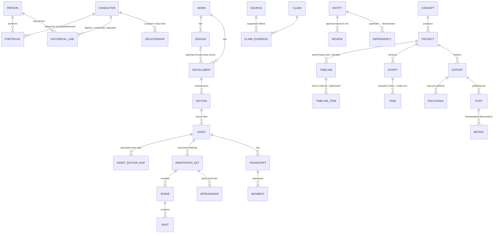

# Architecture: The Iman Cut media research & production system

Smallest working system: **SQLite + Python standard library + ffmpeg**. Open formats throughout; no dependency on any AI model, editor or clipping vendor. The full field list is in `docs/generated/DATA_DICTIONARY.md`, generated from the live schema.

## 1. Entity relationships (five layers)

Cross-cutting tables: `entity` (UUID, display ID, type, rev, redirect), `revision` (full snapshots), `provenance`, `ingestion`, `review_queue`, `rights`, `stale_flag`, `tag`, `audit_log`.

## 2. IDs and versioning policy
- Every record has an immutable **UUID** (primary key) and a **display ID** `PREFIX-######` from a per-prefix counter. IDs are never derived from names, titles, episode numbers, filenames or timestamps, and are **never reused**.
- **Merges:** the duplicate keeps its row and display ID; `entity.retired_to` redirects to the survivor; `Catalog.resolve()` follows redirects; the audit log records why.
- **Revisions:** each create or update writes a full JSON snapshot to `revision` with the changed fields, the ingestion batch and the actor. Nothing is overwritten without a prior revision.
- **Blank never erases:** a blank incoming value is ignored unless `overwrite_blank=True` is passed explicitly.
- **Approvals** (`review`) bind to `(target, rev)` and have separate kinds: identity · history · rights · sensitivity · editorial · technical_qc · publication. Editing the target invalidates them automatically.
- **Change propagation:** `dependency` edges run Sources → Claims/annotations → Scripts/timelines → Narration/subtitles → Exports → Posts. An upstream update writes `stale_flag` rows on every downstream record and never edits approved exports or posts.
- Annotation changes create a **new annotation_set version**; approved timelines keep pointing at the intervals they were built from.
- Legacy labels (`S01E03`, v0 `CHR-003`) live in `installment_number` and `external_id`; they are labels, not keys.

## 3. Timing
- Canonical time base **1/240000 s** (`meta.timebase`). It is exact for 23.976/24/25/29.97/30/50/59.94/60 fps frames and for 48 kHz samples. `to_ticks()` refuses values that would need rounding.
- All intervals are half-open **[start, end)**, enforced by CHECK constraints.
- Three clocks are kept apart: asset time (`appearance`, `scene`, `segment`), edition time (via the piecewise `asset_edition_map`, which handles intros, ad breaks and missing sections) and final-timeline time (`timeline_item.tl_*`).
- VFR assets are flagged (`is_vfr`), and frame numbers are never used as the timing authority.
- Screen time = **union** of confirmed visible intervals per annotation set (no double counting) under the versioned counting method **CM-1**, with coverage reported. It is provisional unless coverage is complete.

## 4. Intake workflow
1. Create an `ING-` record; copy the original into `intake/ING-######/` read-only, with its SHA-256 (identical bytes = no-op).
2. Parse and match: IMDb ID, then normalised name/alias for people; exact name/alias within a work for characters.
3. Auto-link only unique, non-conflicting matches. Everything else goes to `review_queue` (ambiguous · conflict · multi_name_credit · unresolved_reference).
4. Field-level updates with provenance; conflicting evidence is kept, never overwritten.
5. Report: Added / Matched / Updated / Conflicting / Unresolved / Affected outputs (`intake/ING-*/INTAKE_REPORT.md`).
6. Regenerate documents (`python3 -m tic.cli docs`).

## 5. Folder structure
```
iman-cut/
  PROJECT_BRIEF.md  TASK_BOARD.md  DECISION_LOG.md  HANDOFF.md  CORRECTIONS_LOG.md
  catalog/      catalog.sqlite · migrations/00N_*.sql · backups/ (verified restores)
  tic/          core.py · intake.py · production.py · docs.py · cli.py   (title-agnostic code)
  tests/        test_core.py (validation suite)
  intake/       incoming/ (drop zone) · ING-######/ (preserved originals + reports)
  media/        originals/ (read-only, by checksum) · proxies/ · source_reports/   (large files, outside the DB)
  works/        seed_<title>.py (data) · WRK-######_<slug>/ (generated directory, character sheets, installment docs)
  projects/     PRJ-######_<Slug>/ (proposal, scripts, sources, renders, post copy)
  pipeline/     render.sh · cover.sh · qc_probe.sh · source_report.sh · merge_srt.py
  brand/        style samples, watermark spec
  policies/     editorial & sensitivity · moderation · corrections · QC checklist
  analytics/    tracking template (no live integration)
  docs/         ARCHITECTURE.md · generated/ (data dictionary, review queue, rights register)
  legacy/       v0 package (read-only reference)
```

## 6. Implementation status
| Capability | Status |
|---|---|
| Import a cast list (idempotent, matching, queue) | ✅ live on real data (4 batches) |
| Register work/season/installments (movies: no season) | ✅ |
| Register a source asset (ffprobe, checksum, rational fps, VFR, HDR, tracks) | ✅ tested on synthetic media; no real footage yet |
| Character sheets / directory / installment docs from records | ✅ 135 sheets, 8 installment docs |
| Scenes, appearances, union screen time, coverage | ✅ tested |
| Timeline with exact source intervals + reuse tracking | ✅ tested |
| Scripts, packaging, reviews, exports | ✅ (pilot records live; export tested) |
| Correction without losing versions; stale propagation; versioned approvals | ✅ tested |
| Backup + verified restore | ✅ |
| Search & retrieval (all §16 queries) | ✅ `tic/search.py`, tested |
| Narration takes pinned to script rev; outdated detection | ✅ tested |
| Controlled tags | ✅ migration 004 |
| Platform posts / metric observations | Schema + queries tested; no live integration (template only) |

## 7. Next implementation steps (only once there is real input)
Speech-to-text proposals (local, open-source; install needs your OK) → shot-boundary proposals (ffmpeg scene score) → human confirmation UI (Markdown/CSV round-trip first, before any app) → timeline → render bridge (`render.sh` from `timeline_item` rows).
